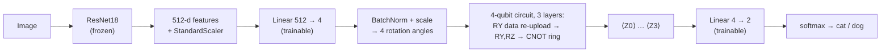

# Noise-Aware Hybrid Quantum-Classical Image Classification

A hybrid model that classifies images (cats vs dogs) with a frozen ResNet18, a trainable
projection, a 4-qubit variational quantum circuit and a linear readout - trained end to end -
and a study of **how quantum noise affects it and how to mitigate that**. Everything runs on a
simulator (PennyLane); real IBM hardware is the remaining phase.

## Findings at a glance

All numbers: 200 held-out test images, mean ± sd over 5 independent trainings, exact
(shot-noise-free) density-matrix simulation. Details, tables and caveats below.

1. **The quantum layer adds no accuracy on this task.** A classical model with the same
   projection and readout but no circuit is as accurate (test 0.952 vs 0.947). The circuit is
   the object of the noise study, not a source of accuracy.
2. **The model tolerates noise up to p ≈ 0.1**: accuracy stays within ~0.015 of noise-free
   (0.943) for bit-flip, phase-flip and depolarizing noise. Beyond p ≈ 0.15 it drops sharply and
   varies a lot between seeds (near chance at p = 0.3 for bit-flip and depolarizing).
3. **Noise destroys the decision boundary, not the information.** ROC-AUC stays ≥ 0.93 in every
   run at every noise level (mean ≈ 0.98) while accuracy collapses: the quantum outputs shrink
   towards 0 (mean |⟨Z⟩| 0.25 → 0.01–0.04) and, at p = 0.3, bit-flip and depolarizing models
   predict almost a single class.
4. **Cheapest fix wins: re-fit the classical readout on noisy calibration data.** Accuracy
   returns to 0.94–0.955 at *every* noise type and strength tested (up to p = 0.3), better than
   unmitigated in 5/5 seeds at p ≥ 0.2. Re-fitting just one decision threshold already recovers
   0.92–0.95.
5. **Noise-aware retraining also works but is dearer and less stable**; **zero-noise
   extrapolation (ZNE)** measurably cleans up ⟨Z⟩ at low noise but gives smaller, less reliable
   accuracy gains and fades at high noise.
6. **Circuit design matters for uncorrected robustness**: 1-layer and entanglement-free circuits
   stay at ≈ 0.93–0.95 at p = 0.2, while deeper *entangled* circuits fall to 0.79–0.90. After the
   readout re-fit, every design is back at ≈ 0.94–0.96.

## Architecture



Projection, circuit weights and readout are trained jointly (Adam, cross-entropy, 60 epochs,
best-validation checkpoint) through `qml.qnn.TorchLayer` with exact back-propagation. The circuit
is batched, so all images run in one simulator call.

**Noise model.** After every executed circuit layer one channel - bit-flip, phase-flip or
depolarizing, strength *p* - is applied to every qubit (`default.mixed`).

## Experimental protocol (why the numbers are comparable)

| | |
|---|---|
| Data | 300 training images (150 cats, 150 dogs) and **200 held-out test images (100 + 100)**, disjoint, breed-balanced; masks / corrupt / tiny files filtered out. No leakage found: no byte-identical files shared, and the nearest training image of any test image has ResNet-feature cosine similarity ≤ 0.91 (mean 0.80, the same as between training images). |
| Seeds | Seed *s* fixes the 80/20 train/validation split, the scaler and the model initialisation. Every study uses seeds 0-4. |
| Model selection | Only on the validation part of the training data. The test set is never used for fitting, checkpointing, calibration or hyper-parameter choice. |
| Weight decay | Chosen on validation accuracy from {1e-4 … 1e-1}: **0.1** for noise-free training (1e-4 overfits and one seed collapses to 0.57), **0.01** for noise-aware training (0.1 collapses there because it stops the readout amplifying a tiny signal). |
| Statistics | mean ± sample sd over seeds; paired differences (mean ± 95 % CI, seeds where better). |
| Integrity | `python -m src.check_results` verifies 5 seeds in every cell, all metrics in [0, 1], and that Phase 4's baseline equals Phase 3's run for run. |

## Phase 1-2 - the hybrid model

| Model | 5-fold CV accuracy | Test accuracy | Test ROC-AUC |
|---|---|---|---|
| classical: no circuit | 0.980 ± 0.014 | 0.952 ± 0.004 | 0.986 |
| frozen random circuit | 0.980 ± 0.014 | 0.943 ± 0.014 | 0.983 |
| **trained circuit (the model used below)** | 0.960 ± 0.025 | 0.947 ± 0.010 | 0.983 |

The three are statistically indistinguishable: on this easy task the 512 → 4 projection and the
linear readout do the work, and a trainable circuit is not needed for accuracy.

## Phase 3 - effect of noise (`results/phase3_summary.md`, `phase3_*.png`)

Test accuracy, ideal-trained model run under noise vs models trained with the noise on:

| noise | p | ideal-trained | AUC | imbalance* | ideal, same weight decay† | noise-aware | aware − ideal (paired) | better in |
|---|---|---|---|---|---|---|---|---|
| none | 0 | 0.943 ± 0.018 | 0.985 | 0.04 | | | | |
| bit-flip | 0.1 | 0.943 ± 0.021 | 0.985 | 0.04 | 0.889 ± 0.092 | 0.954 ± 0.010 | +0.011 ± 0.023 | 3/5 |
| bit-flip | 0.2 | 0.877 ± 0.014 | 0.984 | 0.11 | 0.595 ± 0.196 | 0.927 ± 0.026 | +0.050 ± 0.041 | 4/5 |
| bit-flip | 0.3 | 0.581 ± 0.160 | 0.981 | 0.42 | 0.589 ± 0.199 | 0.947 ± 0.022 | +0.366 ± 0.222 | 5/5 |
| phase-flip | 0.1 | 0.928 ± 0.016 | 0.986 | 0.06 | 0.951 ± 0.013 | 0.894 ± 0.072 | −0.034 ± 0.086 | 2/5 |
| phase-flip | 0.2 | 0.753 ± 0.232 | 0.985 | 0.24 | 0.802 ± 0.211 | 0.936 ± 0.032 | +0.183 ± 0.298 | 3/5 |
| phase-flip | 0.3 | 0.746 ± 0.226 | 0.971 | 0.25 | 0.677 ± 0.220 | 0.923 ± 0.036 | +0.177 ± 0.294 | 3/5 |
| depolarizing | 0.1 | 0.927 ± 0.020 | 0.985 | 0.06 | 0.928 ± 0.034 | 0.917 ± 0.056 | −0.010 ± 0.070 | 2/5 |
| depolarizing | 0.2 | 0.748 ± 0.228 | 0.985 | 0.24 | 0.593 ± 0.202 | 0.954 ± 0.010 | +0.206 ± 0.275 | 5/5 |
| depolarizing | 0.3 | 0.541 ± 0.086 | 0.985 | 0.46 | 0.587 ± 0.195 | 0.823 ± 0.176 | +0.282 ± 0.205 | 5/5 |

\* imbalance = |share of images predicted "dog" − 0.5|, per seed (0 = balanced, 0.5 = a single class).
† control: ideal-trained (no noise while training) with the *same* weight decay as noise-aware
training, to show the gain is not just a weight-decay effect.

- **Robust to p ≈ 0.1, then a cliff.** The mean quantum signal |⟨Z⟩| falls from 0.25 to
  0.04-0.07 at p = 0.2 and 0.01-0.04 at p = 0.3.
- **AUC stays ≈ 0.98 while accuracy collapses** (min over all runs: 0.93). The model still ranks
  images correctly; at p = 0.3 it puts (almost) everything in one class (imbalance 0.42-0.46).
  The failure is a misplaced decision boundary - which is why cheap recalibration works (Phase 4).
- **Noise-aware training helps at p ≥ 0.2** (paired gains +0.05 to +0.37) and does nothing at
  p ≤ 0.1. The control (same weight decay, no noise-aware training) fails at least as badly as
  the ideal-trained model, so the gain comes from training with the noise on.
- **But it is unstable.** 5 of 60 noise-aware runs ended below 0.85 (lowest 0.525; four of the
  five lowest are seed 1). Confidence intervals in the phase-flip and depolarizing rows are wide
  for that reason; only differences that are consistent across seeds should be read as real.

## Phase 4 - mitigation (`results/phase4_summary.md`, `phase4_*.png`)

Test accuracy (mean ± sd, 5 seeds); "re-fit" methods use the ideal-trained circuit and only change
the classical side, calibrated on the 300 training images run through the *noisy* circuit:

| noise | p | none | re-fit threshold | re-fit readout | ZNE folding | ZNE scaling | noise-aware retraining |
|---|---|---|---|---|---|---|---|
| bit-flip | 0.2 | 0.877 ± 0.014 | 0.948 ± 0.018 | 0.948 ± 0.006 | 0.935 ± 0.022 | 0.940 ± 0.015 | 0.927 ± 0.026 |
| bit-flip | 0.3 | 0.581 ± 0.160 | 0.934 ± 0.026 | 0.943 ± 0.012 | 0.704 ± 0.190 | 0.817 ± 0.133 | 0.947 ± 0.022 |
| phase-flip | 0.2 | 0.753 ± 0.232 | 0.936 ± 0.019 | 0.945 ± 0.016 | 0.821 ± 0.179 | 0.924 ± 0.036 | 0.936 ± 0.032 |
| phase-flip | 0.3 | 0.746 ± 0.226 | 0.922 ± 0.038 | 0.944 ± 0.015 | 0.749 ± 0.228 | 0.826 ± 0.183 | 0.923 ± 0.036 |
| depolarizing | 0.2 | 0.748 ± 0.228 | 0.942 ± 0.021 | 0.953 ± 0.010 | 0.882 ± 0.063 | 0.921 ± 0.020 | 0.954 ± 0.010 |
| depolarizing | 0.3 | 0.541 ± 0.086 | 0.943 ± 0.021 | 0.952 ± 0.010 | 0.665 ± 0.161 | 0.732 ± 0.214 | 0.823 ± 0.176 |

**Methods.** *Re-fit threshold*: shift the decision threshold of the existing readout (1
parameter). *Re-fit readout*: refit the linear readout with feature re-scaling. *ZNE*: run the
circuit at amplified noise (scaling: 1×, 2×, 3× the strength; folding: each layer L → L(L†L)^k,
noise 1×, 3×, 5×), extrapolate ⟨Z⟩ to zero noise (Richardson), then apply the unchanged readout.
ZNE is applied to the circuit's **outputs ⟨Z⟩**, not to accuracy.

- **Re-fitting the readout is the best method here**: 0.94-0.955 everywhere, better than
  unmitigated in 5/5 seeds at p ≥ 0.2. Once the noisy calibration runs are done the fit takes
  milliseconds. Re-fitting *one* threshold already recovers most of the loss, consistent with the
  damage being mostly a shifted boundary.
- **ZNE works on the quantity it is meant for.** RMSE of ⟨Z⟩ against its noise-free value
  drops by up to ~9× at low noise (depolarizing p = 0.05: 0.120 → 0.013, scaling + Richardson)
  but the gain fades as the signal is buried (p = 0.3: 0.310 → 0.288). Accuracy gains are
  smaller than from re-fitting and unreliable at p = 0.3. Noise scaling gave the lower ⟨Z⟩ error
  at every p ≤ 0.2 and the higher accuracy than gate folding in all six p ≥ 0.2 cells; a likely
  reason (not tested) is that folding samples noise levels further from zero (1×, 3×, 5×) than
  scaling does (1×, 2×, 3×), so the extrapolation is longer. Only folding carries over to real
  hardware, where the noise strength cannot be dialled.
- **Noise-aware retraining** matches re-fitting in several cells but costs orders of magnitude
  more (1-3 minutes per run vs. a fit in milliseconds) and is less stable (depolarizing p = 0.3:
  0.823 ± 0.176 vs 0.952 ± 0.010).

**Circuit design** (accuracy averaged over the three noise types; mean ± sd over seeds;
every design trained from scratch with the same budget):

| depth | entanglement | noise-free | p = 0.1 | p = 0.2 | p = 0.2, re-fit readout |
|---|---|---|---|---|---|
| 1 | ring | 0.934 ± 0.010 | 0.937 ± 0.010 | 0.938 ± 0.010 | 0.949 ± 0.008 |
| 1 | linear | 0.936 ± 0.021 | 0.935 ± 0.019 | 0.927 ± 0.026 | 0.938 ± 0.023 |
| 1 | none | 0.952 ± 0.012 | 0.952 ± 0.012 | 0.952 ± 0.011 | 0.957 ± 0.006 |
| 2 | ring | 0.940 ± 0.012 | 0.910 ± 0.061 | 0.821 ± 0.128 | 0.955 ± 0.013 |
| 2 | linear | 0.939 ± 0.017 | 0.930 ± 0.027 | 0.904 ± 0.063 | 0.945 ± 0.007 |
| 2 | none | 0.942 ± 0.014 | 0.940 ± 0.009 | 0.935 ± 0.012 | 0.943 ± 0.010 |
| 3 | ring **(main model)** | 0.943 ± 0.018 | 0.933 ± 0.018 | 0.793 ± 0.153 | 0.949 ± 0.010 |
| 3 | linear | 0.939 ± 0.020 | 0.895 ± 0.099 | 0.835 ± 0.187 | 0.950 ± 0.008 |
| 3 | none | 0.956 ± 0.013 | 0.954 ± 0.013 | 0.937 ± 0.033 | 0.953 ± 0.011 |

All designs are equally accurate without noise. Under noise the deeper, entangled ones degrade
most; shallow or entanglement-free ones do not; a re-fitted readout equalises them. Note that
entanglement-free circuits are just as accurate here, i.e. this task does not need entanglement -
the robustness conclusion may not carry over to tasks that do.

## Limitations - read before quoting a number

- **Exact simulation, no shot noise.** On hardware finite shots add sampling error on top of a
  signal that has shrunk to 0.01-0.05, so re-fitting and ZNE will do worse than shown (Phase 5).
- **Idealised noise**: identical single-qubit channels after each layer; no gate-dependent,
  correlated or read-out errors, no crosstalk.
- **Easy task; the classical projection does the work.** Conclusions concern how noise affects
  the circuit's contribution and the readout, not a quantum advantage.
- **5 seeds and 200 test images.** Several cells have wide intervals (seed collapses, one seed is
  consistently harder for noise-aware training). Only effects that are consistent across seeds
  are claimed. Noise-aware training was not tuned beyond weight decay.
- Hyper-parameters other than weight decay (lr 0.05, 60 epochs) were fixed after a convergence
  check (loss and validation accuracy plateau by ~50 epochs; 150 epochs gives identical results).

## Setup

Python **3.10-3.12** (the pinned PyTorch has no wheels for 3.13+). Tested on Windows.

```powershell
py -3.12 -m venv .venv
.venv\Scripts\Activate.ps1
pip install -r requirements.txt
```

In VS Code: Ctrl+Shift+P → "Python: Select Interpreter" → `.venv`.

## Data

The photos are **not** in the repository. Put cat images under `data/raw_full/class0/` and dog
images under `data/raw_full/class1/` (any sub-folder depth; the study used 1,420 cat and 2,400 dog
photos organised by breed), then build the splits:

```powershell
python -m src.build_dataset      # -> data/train/class0|class1 (150 each), data/test/class0|class1 (100 each)
```

`data/test/cat.jpg` and `dog.jpg` (optional) are used by the quick demo `python -m src.predict`.

## Reproduce everything

```powershell
python -m src.train                        # main model -> models/qml_model.pkl        (~1.5 min)
python -m src.evaluate --circuit trained   # Phase 1-2 table; also: --circuit fixed | none (a few min each)

python -m src.noise_study --stage inference   # Phase 3: ideal-trained models under noise (~2 min)
python -m src.noise_study --stage aware       # Phase 3: noise-aware training, 60 runs   (~1.5-2 h, resumable)
python -m src.noise_study --stage control     # Phase 3: weight-decay control            (~2 min)
python -m src.noise_study --stage report      # tables + figures

python -m src.phase4 --stage recal            # re-fit threshold / readout               (~1 min)
python -m src.phase4 --stage zne              # zero-noise extrapolation                 (~1 min)
python -m src.phase4 --stage design           # circuit depth x entanglement sweep       (~15 min)
python -m src.phase4 --stage report           # tables + figures

python -m src.check_results                # integrity checks on all of the above
python tests/test_smoke.py                 # 16 fast unit tests
streamlit run app.py                       # demo: upload up to 2 images
```

Times are for a CPU-only laptop. Run everything from the project root. Ideal models are cached in
`models/cache/` (keyed by circuit design, seed and training recipe); ResNet features in
`models/resnet_*.npz` (delete or use `--refresh` after changing the data).

## Project structure

```
qml_image_classifier/
├── app.py                 Streamlit demo: prediction + "inside the circuit" (angles, per-layer ⟨Z⟩, drawing)
├── requirements.txt       pinned versions used for every result
├── src/
│   ├── config.py          all hyper-parameters (CFG)
│   ├── build_dataset.py   filtered, balanced train / held-out test split from data/raw_full
│   ├── preprocessing.py   224x224 + ImageNet normalisation
│   ├── feature_extractor.py  frozen ResNet18 → 512-d
│   ├── quantum_model.py   the circuit: entanglement options, noise channels, gate folding, tracing
│   ├── model.py           HybridModel + fit()
│   ├── train.py           trains and saves the main model
│   ├── evaluate.py        Phase 1-2: k-fold CV + multi-seed held-out test
│   ├── experiments.py     shared protocol: data, seeds, model cache, metrics, statistics
│   ├── noise_study.py     Phase 3
│   ├── phase4.py          Phase 4: re-fit, ZNE, design sweep, report
│   ├── check_results.py   integrity checks on the result files
│   ├── predict.py         inference + explain_image (used by the app)
│   ├── tracking.py        results/metrics.csv (idempotent log)
│   ├── ibm_setup.py       Phase 5: save your IBM Quantum credentials + verify access
│   └── phase5.py          Phase 5: run the circuit on real hardware, compare to simulators
├── tests/test_smoke.py
├── models/qml_model.pkl   trained main model (so the demo runs without retraining)
└── results/               raw per-run CSVs, summary tables (*.md) and figures
```

## Phase 5 - running on real IBM Quantum hardware

**Done.** 15 held-out test images run on real hardware (`ibm_kingston`, a 156-qubit device),
compared against the ideal simulator and Phase 3's noisy simulator at p = 0.1 depolarizing.
Total cost: **37 seconds of QPU time** (of a 600-second/month free-tier quota) across a 1-image
connectivity check and the 15-image run - see `results/phase5_raw.csv`, `phase5_comparison.png`.

| comparison | RMSE of ⟨Z⟩ vs ideal | mean \|diff\| | correlation |
|---|---|---|---|
| real hardware vs ideal | **0.113** | 0.093 | 0.990 |
| noisy simulator (p=0.1 depolarizing) vs ideal | 0.327 | 0.276 | 0.992 |

**Findings**

- **Real hardware is markedly closer to ideal than our p = 0.1 noise model.** The idealised
  single-qubit depolarizing channel used throughout Phases 3-4 is a *pessimistic* stand-in for
  this specific shallow (3-layer, 4-qubit) circuit on `ibm_kingston` - real ⟨Z⟩ values track the
  ideal simulator about 3x more closely than the matched simulated-noise condition does (RMSE
  0.113 vs 0.327). This should be read as evidence for *this circuit and backend*, not a general
  claim about simulated vs real noise.
- **Accuracy was 100% on all three (ideal, noisy simulator, real hardware)** for these 15 images -
  expected given Phase 3's finding that ROC-AUC survives noise; a 15-image sample is too small to
  measure a real accuracy gap and isn't meant to be.
- **Important caveat on what "real hardware" means here**: Qiskit Runtime's `EstimatorV2`
  applies measurement-error mitigation by default (confirmed in the job metadata:
  `resilience: {measure_mitigation: True}`, gate twirling enabled). The comparison above is
  therefore *device noise with IBM's standard readout mitigation already applied*, not raw
  uncorrected hardware noise - a stronger and more realistic baseline than "no mitigation at
  all", but not the same thing as the unmitigated physical noise.
- **Batching matters a lot for quota.** The naive approach (PennyLane's `qml.device("qiskit.remote", ...)`
  broadcasting a batch) silently ran only the *first* image and quietly dropped the rest - this
  was caught by checking the returned job's pub count, not by an error. The working version
  (`quantum_model.run_on_backend`) submits every image as a separate **pub** within one Qiskit
  Runtime `Estimator` job directly, which is what keeps a 15-image comparison to 15 seconds of
  QPU time instead of 15 separate job overheads.

### Gate-folding ZNE on real hardware

For the same 15 images, each circuit was also run at fold = 1 and fold = 2 (gate-folding
amplifies noise by 3x and 5x - see `quantum_model.build_qiskit_circuit`), and ⟨Z⟩ was
Richardson-extrapolated back to zero noise, exactly as in Phase 4's `zne-fold-rich`. All three
fold levels for all 15 images went into **one** Runtime job. Cost: **20 seconds** (running total:
57 of 600). Results in `results/phase5_zne_raw.csv`, `phase5_zne.png`.

| condition | RMSE of ⟨Z⟩ vs ideal |
|---|---|
| fold = 0 (raw hardware, no folding) | 0.113 |
| fold = 1 (3x noise) | **0.082** |
| fold = 2 (5x noise) | **0.081** |
| ZNE, Richardson-extrapolated to zero noise | 0.160 (worse than raw) |

**This is a genuine negative result, and it's worth reporting as one.** Gate-folding ZNE assumes
error grows monotonically with the fold level, so extrapolating the trend back to zero recovers
the ideal value. Here the opposite happened: folded (noisier-by-construction) circuits came out
*closer* to ideal than the unfolded one, so extrapolating "forward" from that reversed trend
overshoots and produces a *worse* estimate than simply not mitigating at all. Accuracy was
unaffected (100% at every fold level and after extrapolation) only because this task has enough
margin that none of these deviations were ever going to flip a prediction.

A plausible explanation (not verified here): IBM's `EstimatorV2` applies gate twirling and
measurement-error mitigation by default, and dynamical-decoupling-style effects can make a
longer, more symmetric folded circuit behave *better*, not worse, on real hardware - the opposite
of the simple per-gate-error model folding assumes. This directly validates the caveat above: an
idealized noise model (simulated depolarizing, or the "more folding = more error" assumption
behind ZNE) does not automatically transfer to a real device with its own error-suppression
stack already switched on. It's a genuinely useful thing to know before relying on gate-folding
ZNE for this circuit/backend combination - and precisely the kind of result Phase 5 was for.

### Reproduce it / run more

```powershell
python -m src.ibm_setup                              # one-time: save your credentials (see below)
python -m src.phase5 --stage smoke --fake             # zero-cost dry run against a local fake backend
python -m src.phase5 --stage smoke                    # cheapest real-hardware check (needs confirmation)
python -m src.phase5 --stage run --n 15 --shots 1024  # the real comparison (needs confirmation)
python -m src.phase5 --stage report                   # table + results/phase5_comparison.png
python -m src.phase5 --stage zne --n 15 --shots 1024  # gate-folding ZNE (needs --stage run --n 15 first)
```

`--yes` skips the interactive confirmation for scripted runs; `run_on_backend` always prints
the job id so you can check its cost afterwards with `QiskitRuntimeService().usage()`.

### Getting your own API key

If you're setting this up fresh (a different account, or after your key expires):

### 1. Get an API key

IBM retired the old "IBM Quantum" login in 2024; access now goes through **IBM Cloud**.

1. Go to **cloud.ibm.com** and create a free IBM Cloud account (email + password; a phone
   number is required for verification). This is separate from any old IBM Quantum login.
2. In the IBM Cloud console, create a **Quantum** resource: catalog search "Quantum" →
   choose the free "Open" plan (limited monthly runtime, currently a small number of seconds
   - enough for a handful of Phase 5 test images, not for retraining) → create the instance.
3. Open that instance's page and copy its **CRN** (a long string starting `crn:v1:bluemix:...`)
   - this is the `--instance` value below.
4. Go to **Manage → Access (IAM) → API keys** → **Create an API key** → copy it immediately
   (IBM shows it once). This is your token.

Treat the API key like a password: don't paste it into a shared chat, screenshot, or commit it.
If it's ever exposed, delete it on the IAM page and create a new one.

### 2. Save it on your machine (not in this repo)

```powershell
$env:IBM_QUANTUM_TOKEN = "paste-your-api-key-here"
$env:IBM_QUANTUM_INSTANCE = "crn:v1:bluemix:paste-your-instance-crn-here"
python -m src.ibm_setup
```

This calls `QiskitRuntimeService.save_account(...)`, which writes the credentials to
`~/.qiskit/qiskit-ibm.json` - outside this project folder, never committed. It then lists the
backends your instance can see and their queue lengths, so you know it worked before spending
any quota. Re-run it any time (e.g. after rotating the key); it overwrites the saved account.

Phase 5 is inference only - training on hardware is impractical (queue time and shot cost per
circuit evaluation).

## Roadmap

**All 5 phases are complete**: hybrid model (1-2), noise study (3), mitigation and circuit-design
sweep (4), real IBM Quantum hardware including gate-folding ZNE (5). Total real-hardware spend:
57 of 600 free-tier seconds/month; 543 remain.

Possible extensions, none required to consider the project done: the Phase 4 readout re-fit
applied to real-hardware ⟨Z⟩ (cheap - classical-only, no additional quota); a larger hardware
sample now that the true per-image cost (~1 second) is known; investigating *why* folding
reversed on real hardware (Phase 5's ZNE finding) by inspecting per-gate error rates or trying
`measure_mitigation=False` for a more apples-to-apples comparison with the simulated noise model.
